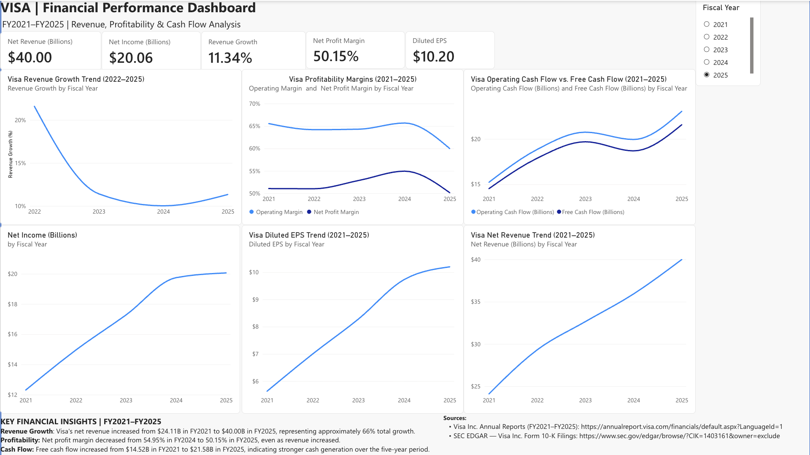
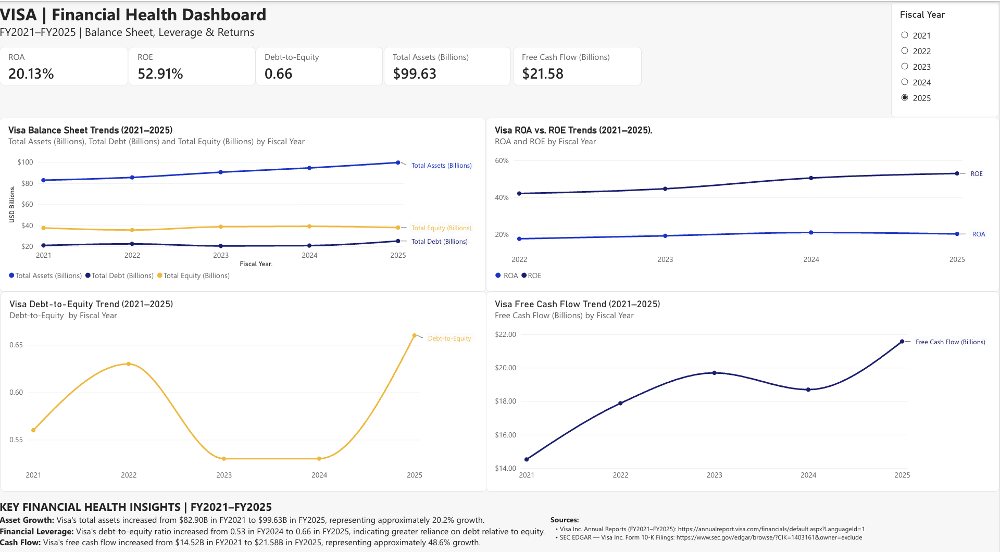

# Visa Financial Analysis Dashboard

Financial Statement Analysis | Microsoft Excel | Power BI | FY2021–FY2025

## Project Overview

This project analyzes Visa Inc.'s financial performance over five fiscal years (2021–2025) using Microsoft Excel and Power BI.

I developed two interactive financial dashboards to evaluate revenue growth, profitability, cash flow, financial leverage, and overall financial health.

The objective was to transform financial statement data into meaningful insights that support financial analysis and business decision-making.

## Dashboard 1: Financial Performance

This dashboard examines revenue, profitability, and cash flow performance, including:

- Net revenue and revenue growth
- Net income and net profit margin
- Operating margin
- Diluted earnings per share (EPS)
- Operating cash flow and free cash flow

## Dashboard 2: Financial Health

This dashboard evaluates Visa's balance sheet and financial health, including:

- Total assets, equity, and debt
- Return on Assets (ROA)
- Return on Equity (ROE)
- Debt-to-Equity ratio
- Free cash flow trends

## Key Financial Insights

Revenue Growth: Visa's net revenue increased from $24.11 billion in FY2021 to $40.00 billion in FY2025, representing approximately 66% total growth.

Profitability: Visa's net profit margin declined from 54.95% in FY2024 to 50.15% in FY2025, despite revenue growth.

Cash Flow:Free cash flow increased from $14.52 billion in FY2021 to $21.58 billion in FY2025, representing approximately 48.6% growth.

Financial Leverage: The debt-to-equity ratio increased from 0.53 in FY2024 to 0.66 in FY2025.

## Tools & Skills

- Microsoft Excel:Financial data preparation, ratio calculations, and trend analysis
- Power BI:Dashboard development, interactive filters, KPI cards, and data visualization
- Financial Analysis: Financial statement analysis, profitability, leverage, and cash flow evaluation

## Methodology

1. Collected financial statement figures from Visa's annual reports and SEC filings.
2. Organized five years of financial data in Excel.
3. Calculated financial ratios and performance metrics.
4. Developed two interactive Power BI dashboards.
5. Identified financial trends and summarized key findings.

Financial statement amounts are recorded in USD millions in the Excel dataset and displayed in USD billions in the dashboards, except EPS and ratios. ROA and ROE use average assets and equity, respectively.

## Data Sources

- [Visa Inc. Annual Reports](https://annualreport.visa.com/financials/default.aspx?LanguageId=1)
- [SEC EDGAR — Visa Inc. Form 10-K Filings](https://www.sec.gov/edgar/browse/?CIK=1403161&owner=exclude)

## Project Files

- `Visa_Financial_Data.xlsx` — Financial dataset and calculated metrics
- `financial-performance.png` — Financial Performance Dashboard
- `financial-health.png` — Financial Health Dashboard

This is an independent educational portfolio project and is not affiliated with Visa Inc.
